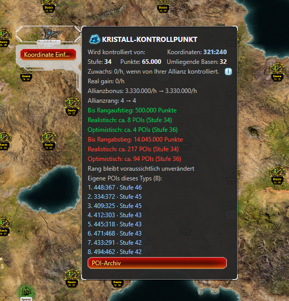
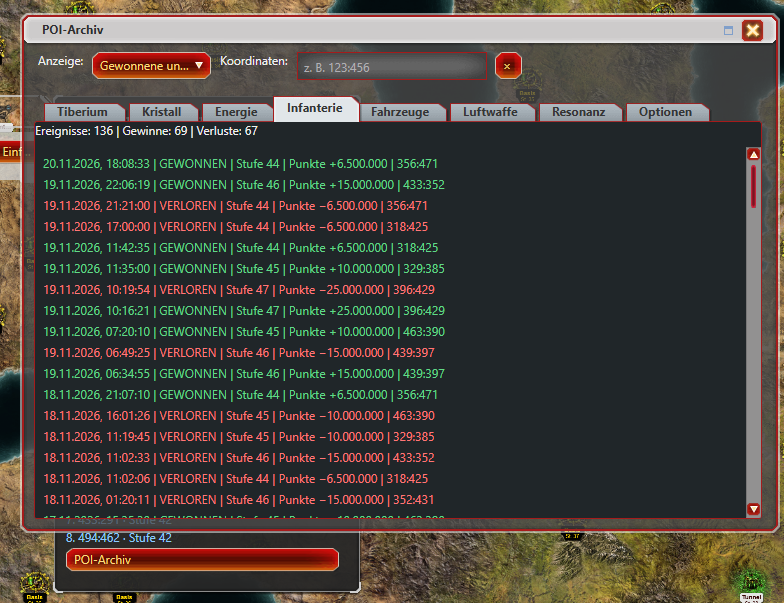
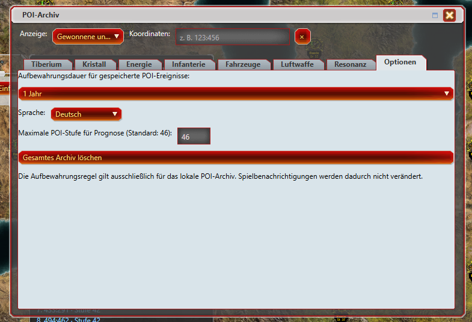

# Tiberium Alliances Real POI Bonus HE

Eine umfangreich erweiterte Version des ursprünglichen Userscripts **Tiberium Alliances Real POI Bonus** von **petui**, weiterentwickelt und ergänzt durch **Harzi**.

Das Script erweitert die ursprüngliche POI-Bonus-Anzeige um ein lokales Ereignisarchiv, eine automatische Hintergrundsynchronisierung, Rangprognosen, eine Koordinatensuche mit Kartenavigation, konfigurierbare Prognosewerte und eine mehrsprachige Benutzeroberfläche.

## Funktionen

### POI-Bonus-Übersicht

- Zeigt Informationen zum aktuell ausgewählten Point of Interest (POI).
- Zeigt den Allianzbonus und Informationen zum aktuellen Allianzr ang.
- Berechnet die benötigten POI-Punkte für einen möglichen Rangaufstieg oder Rangabstieg.
- Bietet sowohl **realistische** als auch **optimistische** Prognosen für Gewinne und Verluste.
- Zeigt die jeweils zugrunde gelegte POI-Stufe für jede Prognose an.
- Listet die eigenen POIs des jeweiligen Typs einschließlich Koordinaten und Stufen auf.
- Ermöglicht das direkte Zentrieren der Weltkarte auf einen eigenen POI durch Anklicken seiner Koordinaten.

### POI-Archiv

- Speichert gewonnene und verlorene POI-Ereignisse lokal.
- Führt beim ersten Start einen historischen Datenabgleich durch.
- Verwendet bei späteren Spielstarts eine inkrementelle Synchronisierung, um neue Ereignisse zu erfassen.
- Sammelt Ereignisse automatisch im Hintergrund. Das Öffnen des Archivs ist dafür nicht erforderlich.
- Führt ein eigenes Archiv unabhängig von der Benachrichtigungsliste des Spiels.
- Bietet separate Registerkarten für alle sieben POI-Kategorien:

  - Tiberium
  - Kristall
  - Energie
  - Infanterie
  - Fahrzeuge (Uran)
  - Luftwaffe
  - Resonanz

### Suche und Kartenavigation

- Durchsucht archivierte POI-Ereignisse anhand ihrer Koordinaten.
- Ermöglicht die gezielte Suche nach bestimmten Kartenpositionen.
- Ein Klick auf ein archiviertes Ereignis schließt das Archiv und zentriert die Weltkarte automatisch auf die entsprechenden Koordinaten.

### Einstellungen und Konfiguration

- Auswahl der Aufbewahrungsdauer für archivierte Ereignisse:
  - 3 Monate
  - 6 Monate
  - 1 Jahr
  - 2 Jahre
  - Unbegrenzt
- Individuelle Einstellung der maximalen POI-Stufe für Prognosen (Standard: **46**).
- Die optimistische Prognose berücksichtigt bis zu zwei POI-Stufen oberhalb der tatsächlich ausgewählten POI-Stufe, begrenzt durch die konfigurierte Maximalstufe.
- Auswahl der Benutzeroberflächensprache:
  - Deutsch
  - Englisch
  - Französisch
  - Spanisch
- Filter für die Archivansicht:
  - Gewonnene und verlorene POI
  - Nur gewonnene POI
  - Nur verlorene POI
- Möglichkeit, das gesamte lokale POI-Archiv zu löschen.

## Screenshots

### 1. POI-Bonus-Übersicht

### 2. POI-Ereignisarchiv

### 3. Archivoptionen und Einstellungen

## Installation

1. Installiere einen Userscript-Manager wie [Tampermonkey](https://www.tampermonkey.net/).
2. Öffne die Scriptdatei in diesem Repository:

   [Tiberium_Alliances_Real_POI_Bonus_HE.user.js](Tiberium_Alliances_Real_POI_Bonus_HE.user.js)

3. Klicke auf **Raw**.
4. Tampermonkey erkennt das Userscript und bietet die Installation an.
5. Bestätige die Installation.

## Updates

Das Script enthält die Einträge `@downloadURL` und `@updateURL` im Script-Header.

Beide verweisen auf die aktuelle Version im `main`-Branch dieses GitHub-Repositories.

Dadurch kann der verwendete Userscript-Manager selbstständig nach verfügbaren Updates suchen und diese installieren.

## Kompatibilität

Entwickelt für das browserbasierte Spiel **Command & Conquer: Tiberium Alliances**.

Kompatibel mit Userscript-Managern, die die im Script verwendeten Metadaten unterstützen, beispielsweise Tampermonkey.

## Credits und Lizenz

- **Originalautor:** petui – ursprüngliches Script und technische Grundlage.
- **Weiterentwicklung:** Harzi – umfangreiche Funktionserweiterungen, Anpassungen und laufende Pflege der HE-Version.

Dieses Projekt wird unter der **GNU General Public License Version 3 oder höher (GPL-3.0-or-later)** veröffentlicht.

Weitere Informationen zur Lizenz:

[GNU General Public License v3.0](https://www.gnu.org/licenses/gpl-3.0.html)

Die Arbeit des ursprünglichen Autors petui wird ausdrücklich anerkannt. Die HE-Version baut auf diesem ursprünglichen Script auf und erweitert es um zahlreiche zusätzliche Funktionen.
